# Elite Gym — Full-Stack Gym Booking Platform

A full-stack booking platform for gym classes, self-care sessions, personal
trainers and locker rentals. Customers browse, pick a slot and pay with Stripe;
staff manage everything from an admin dashboard.

The focus is the backend problems most CRUD projects skip: **race-condition-safe
booking, idempotent payment webhooks, and secure token rotation** — all covered
by **196 automated tests**.


<!-- Add a live link once deployed:  **Live demo:** https://your-app.onrender.com -->

<p align="center">
  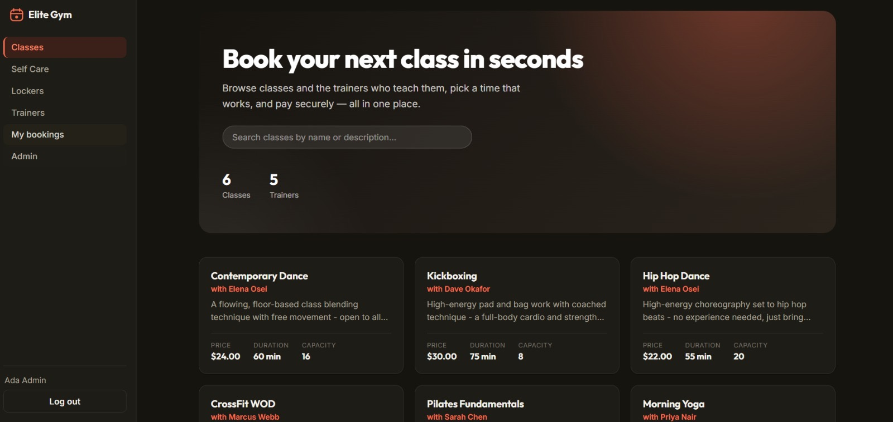
</p>

---

## Screenshots

### Customer side

| | |
| --- | --- |
| 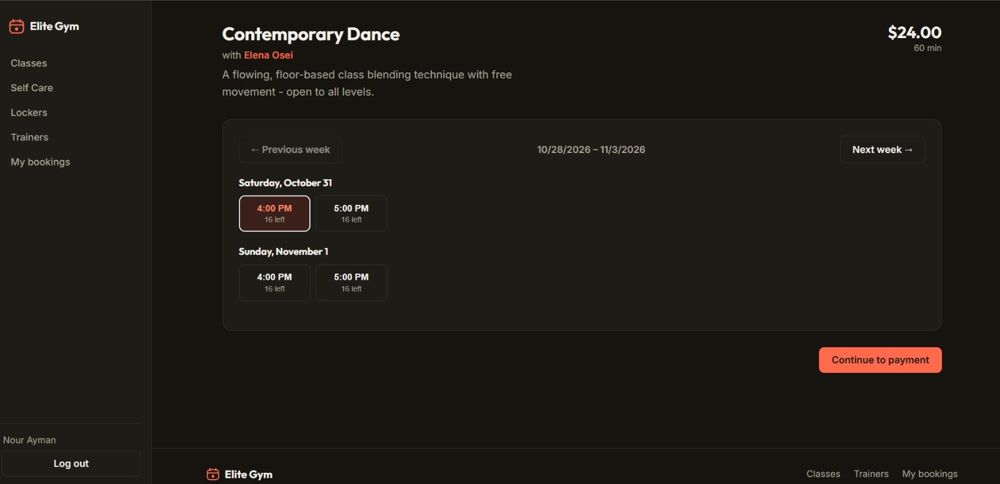 | 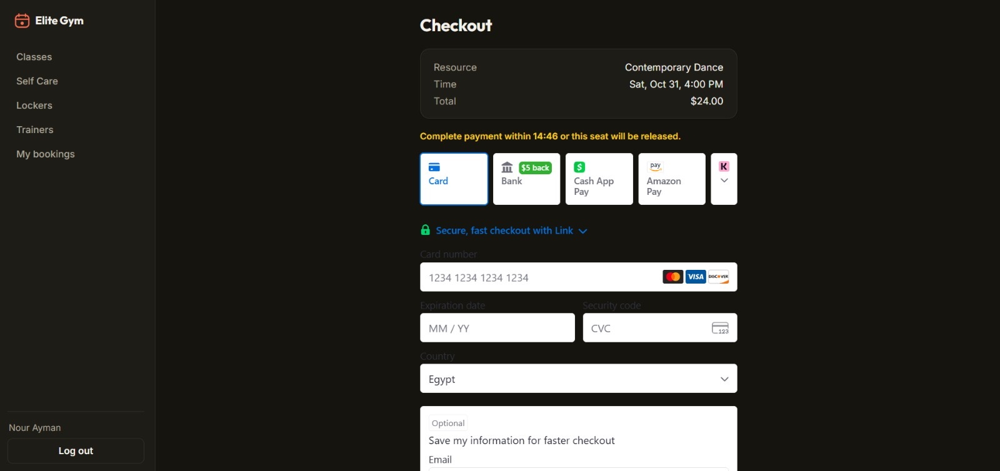 |
| **Pick a slot** — live seats left per time | **Stripe checkout** — seat held with a countdown |
| 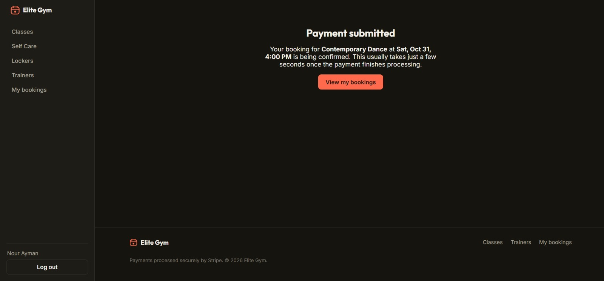 | 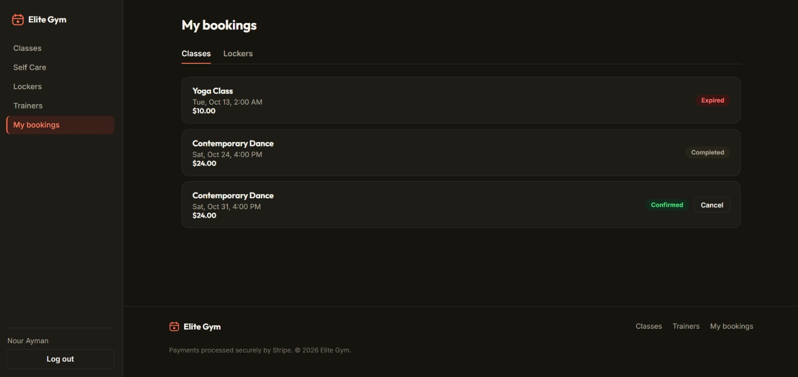 |
| **Payment submitted** — confirmed by webhook | **My bookings** — status badges and cancel |
| 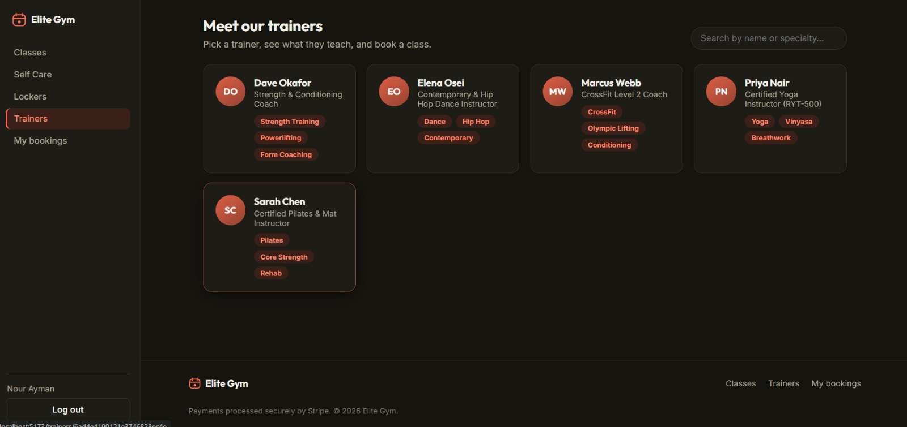 | 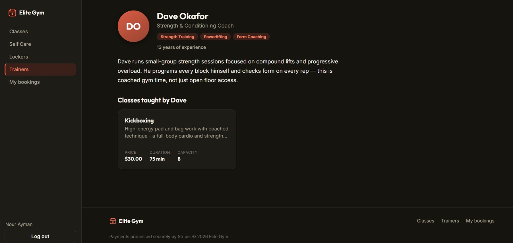 |
| **Trainers** — searchable by name or specialty | **Trainer profile** — bio and their classes |
| 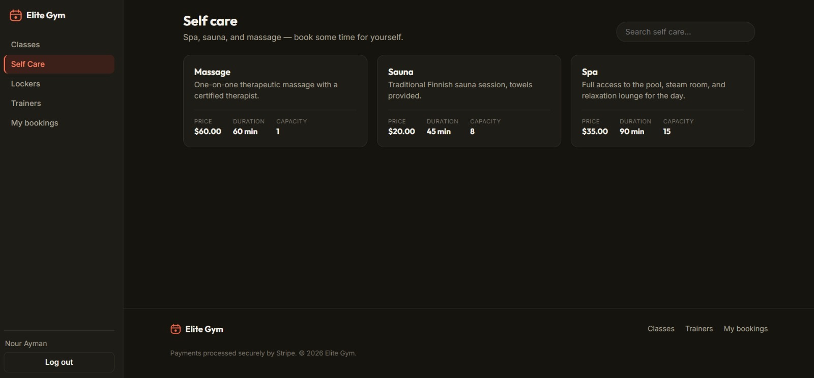 | 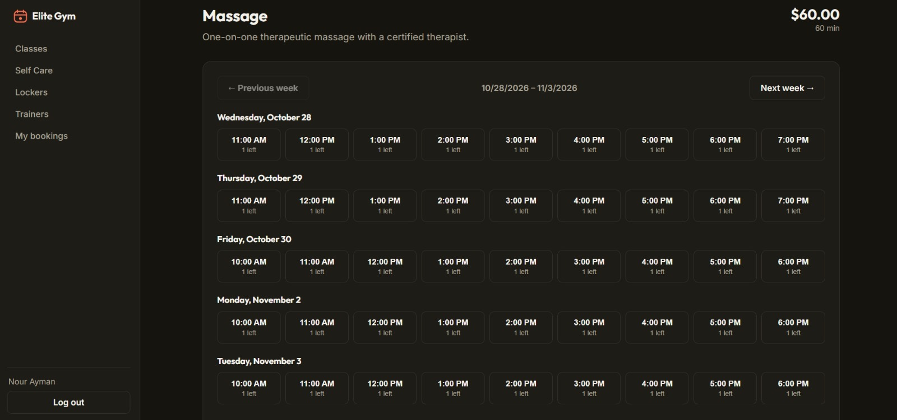 |
| **Self care** — spa, sauna and massage | **Weekly availability** from opening hours |
| 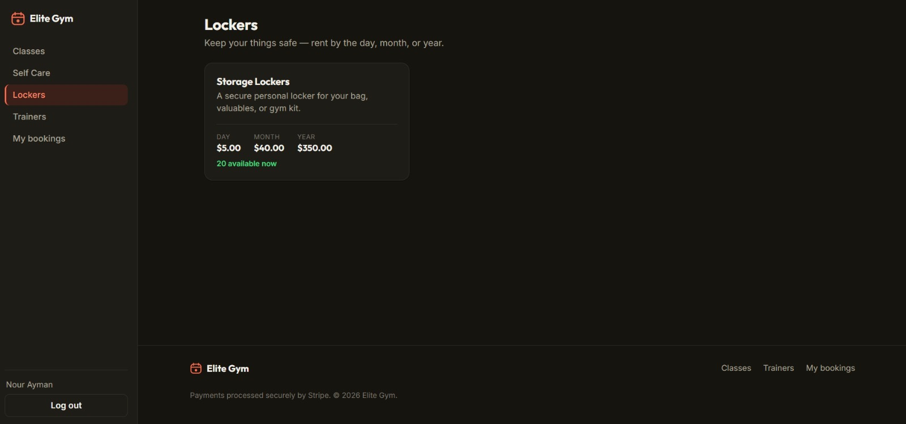 | 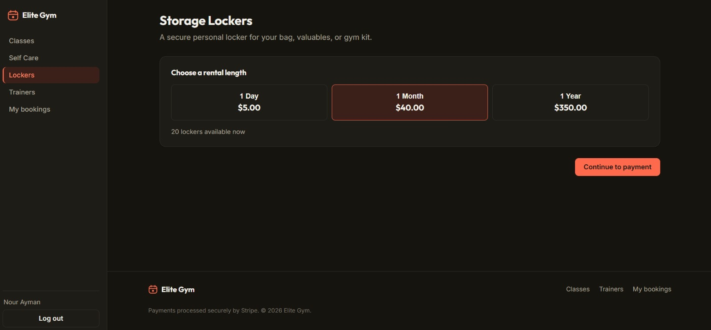 |
| **Lockers** — live availability | **Rent by day, month or year** |

### Admin side

| | |
| --- | --- |
| 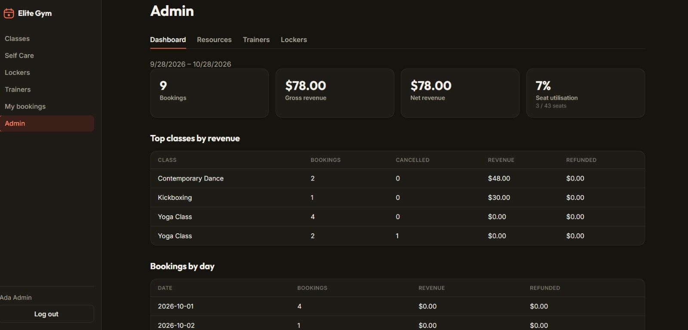 | 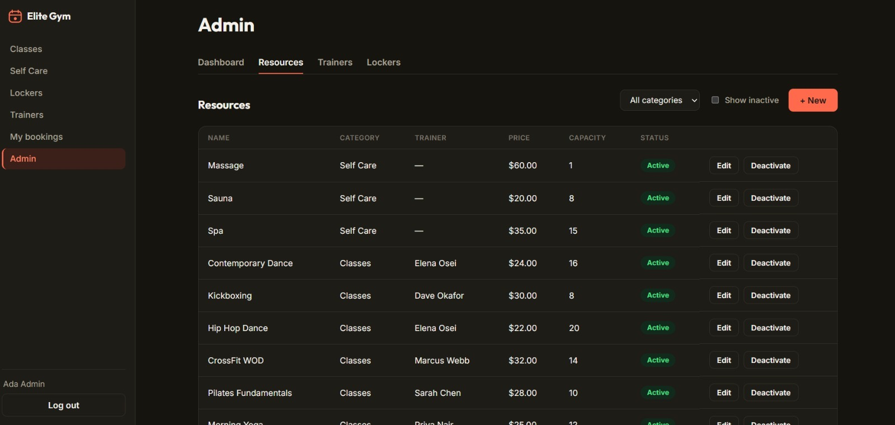 |
| **Dashboard** — bookings, revenue, utilisation | **Classes & self care** — CRUD and deactivate |
| 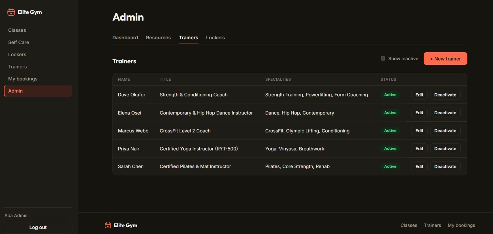 | 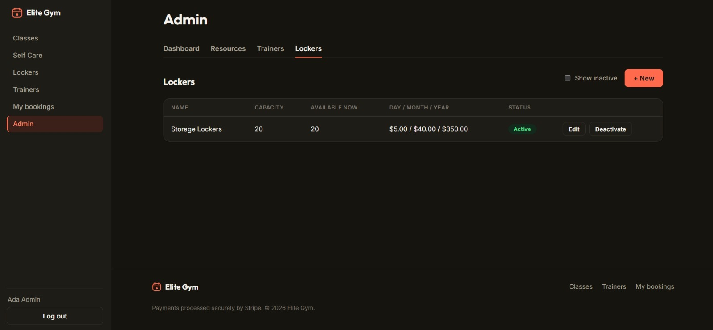 |
| **Trainers** management | **Locker offerings** with live availability |

<details>
<summary>Login</summary>

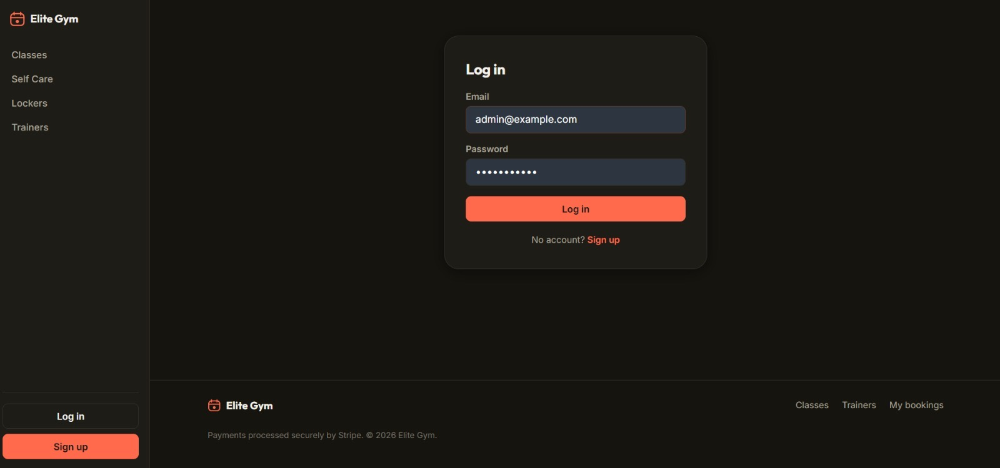

</details>

---

## Highlights

- **No overbooking, even under concurrent requests** — capacity is enforced by
  one atomic conditional update per slot, proven by concurrency tests
- **Stripe payments with an idempotent webhook** — every seat release happens
  exactly once, even when Stripe redelivers events
- **Abandoned checkouts don't leak capacity** — a background sweeper expires
  unpaid bookings and frees the seat; late payments are refunded automatically
- **Secure auth** — JWT access + rotating refresh tokens, bcrypt passwords,
  rate-limited login, role-based access (`admin` / `staff` / `customer`)
- **Timezone-aware recurring schedules** — slots are generated from weekly
  opening hours and stay correct across daylight-saving changes
- **Locker rentals** — day / month / year rentals from a pool of physical units,
  race-free using a different mechanism than class booking
- **Admin dashboard** — bookings, revenue, refunds, seat utilisation and top
  classes, plus full management of classes, trainers and lockers
- **Documented API** — OpenAPI 3 / Swagger UI at `/api/docs`

## Tech stack

| Layer | Tools |
| --- | --- |
| Backend | Node.js, Express, MongoDB, Mongoose |
| Frontend | React 18, Vite, React Router, Stripe Elements |
| Auth & security | JWT, bcrypt, Helmet, express-rate-limit, CORS |
| Payments | Stripe PaymentIntents + webhooks |
| Validation & docs | Zod, OpenAPI 3 (swagger-jsdoc, Swagger UI) |
| Email | Nodemailer (SMTP) |
| Testing | Jest, Supertest, mongodb-memory-server |
| Deployment | Render Blueprint (`render.yaml`) |

## Features

**Customers**
- Register / log in, browse classes, self-care sessions and trainers
- Pick an available time slot and pay with Stripe
- Rent a locker by the day, month or year
- View and cancel bookings (with automatic refund)
- Confirmation, cancellation and expiry emails

**Staff & admins** (`/admin`)
- Dashboard: bookings, revenue, refunds, seat utilisation, top classes by revenue
- Create, edit, deactivate and reactivate classes, trainers and locker offerings
- Weekly opening-hours editor per class

## Getting started

**Requirements:** Node.js 18+, a MongoDB replica set (MongoDB Atlas works —
transactions need a replica set), and a Stripe test account.

```bash
# 1. API
npm install
cp .env.example .env      # MongoDB URI, two JWT secrets, Stripe keys,
                          # CLIENT_URL=http://localhost:5173
npm run seed              # optional: demo users and data
npm run dev               # http://localhost:5000  (docs: /api/docs)

# 2. Frontend (new terminal)
cd frontend
npm install
cp .env.example .env      # API URL + Stripe *publishable* key
npm run dev               # http://localhost:5173
```

**Demo accounts** (after seeding), all with password `password123`:
`admin@example.com`, `staff@example.com`, `customer@example.com`

Change a user's role: `npm run promote -- someone@example.com staff`

**Stripe webhooks locally:**

```bash
stripe listen --forward-to localhost:5000/api/webhooks/stripe
```

Put the printed `whsec_...` value in `STRIPE_WEBHOOK_SECRET`.

> `VITE_STRIPE_PUBLISHABLE_KEY` must come from the *same* Stripe account as the
> API's `STRIPE_SECRET_KEY`, or the payment form renders empty.

### Tests

```bash
npm test
```

196 Jest + Supertest tests, including concurrency, webhook idempotency and
capacity release. The suite starts an in-memory MongoDB replica set, so no
external database is needed.

## How booking works

```
GET  /api/resources/:id/availability   → pick a slot where bookable = true
POST /api/bookings                     → "pending" booking + Stripe clientSecret + expiresAt
     (customer pays in the browser with Stripe Elements)
POST /api/webhooks/stripe              → booking becomes "confirmed"
```

If the customer never pays, the sweeper expires the booking and frees the seat.
All money values are integers in the smallest currency unit (cents).

---

## Engineering decisions

### 1. Overbooking is prevented by a counter, not a transaction

The obvious approach — count active bookings, insert if under capacity, wrap it
in a transaction — **does not work** in MongoDB. Transactions only detect a
conflict when two of them touch the *same document*. Two concurrent requests
each inserting a new `Booking` never collide, so both read the same count and
both pass the capacity check.

Instead, each `(resource, slotStart)` has one `BookingSlot` document holding a
counter, and reserving a seat is a single conditional update:

```js
BookingSlot.findOneAndUpdate(
  { resourceId, slotStart, $expr: { $lt: ['$bookedCount', '$capacity'] } },
  { $inc: { bookedCount: 1 } }
)
```

Single-document updates are atomic, so the check and the increment can't
interleave. `tests/booking.concurrency.test.js` fires simultaneous requests at
3-seat and 1-seat slots and asserts the counts hold.

The counter document is created *outside* the transaction: inside one, losing
the create race raises a duplicate-key error that aborts the whole transaction.

### 2. Every seat release happens exactly once

Seats are freed on cancellation, payment failure and checkout expiry — and
Stripe delivers webhooks *at least* once. Each release is gated on a
conditional status change:

```js
Booking.findOneAndUpdate({ _id, status: 'pending' }, { status: 'cancelled' })
```

Only the caller whose update matched decrements the counter; a redelivered
event finds the booking already moved and does nothing. Webhook event IDs are
also stored in a deduplication collection, and a `$gt: 0` guard on the
decrement is a final backstop.

### 3. Abandoned checkouts and late payments

A `pending` booking holds a seat and carries an `expiresAt`. A sweeper
(`src/jobs/bookingMaintenance.js`) expires unpaid bookings and returns the
seat. Its transition is conditional too, so a payment confirming at the same
moment is never expired out from under the customer — and a payment that lands
*after* expiry is refunded rather than confirming a seat that may have been
resold.

Stripe can't take part in a MongoDB transaction, so bookings are confirmed only
when the webhook reports success, never optimistically.

### 4. Refresh-token rotation — and why bcrypt broke it

Each refresh invalidates the previous token: the stored hash is compared, then
replaced. The hash is **SHA-256, not bcrypt**. bcrypt ignores everything after
the first 72 bytes, and a JWT's first 72 bytes (header + start of
`{"sub":"<user id>`) are identical for every token a user receives — so bcrypt
couldn't tell them apart and rotation silently did nothing.
`tests/tokens.test.js` demonstrates the collision.

On the frontend, the access token lives in memory only (never `localStorage`,
where XSS could read it); the client refreshes once transparently on a 401.

### 5. Timezone-aware recurring availability

Slots are generated on demand from weekly opening hours instead of being
stored, so a schedule is a few rows rather than thousands of documents. Hours
are wall-clock times in the resource's own IANA timezone, so "Mondays 09:00"
stays 09:00 across a DST change. `src/utils/timezone.js` does this with `Intl`
alone — no date library. Bookings are validated against the same generator, so
an arbitrary timestamp can't be booked.

### 6. Lockers: a different race, a different fix

A class booking reserves a *point in time*; a locker rental reserves a *span*,
so there's no shared instant to count against. Each physical locker is its own
`LockerUnit` with an `occupiedUntil` date, and claiming one is still a single
atomic update:

```js
LockerUnit.findOneAndUpdate(
  { offeringId, $or: [{ occupiedUntil: null }, { occupiedUntil: { $lte: now } }] },
  { $set: { occupiedUntil: rentalEnd } }
)
```

Everything else — lifecycle, Stripe webhook (routed by a `bookingType`
metadata tag), sweeper, refunds — reuses the class-booking code.
`tests/lockers.test.js` runs the same concurrency checks.

### Trainers

A `Trainer` is a staff-managed profile (bio, specialties, photo), deliberately
not tied to a `User` account. A class optionally links to a trainer, so booking
a trainer means booking one of their classes through the normal flow.
`GET /api/trainers/:id` returns the profile plus their active classes.

---

## API overview

Full interactive docs at `/api/docs` (raw spec: `/api/openapi.json`).

| Method | Path | Access |
| --- | --- | --- |
| `POST` | `/api/auth/register` · `/login` · `/refresh` | public |
| `GET` / `POST` | `/api/auth/me` · `/logout` | authenticated |
| `GET` | `/api/resources`, `/:id`, `/:id/availability` | public |
| `POST` | `/api/resources` | staff, admin |
| `PATCH` / `DELETE` | `/api/resources/:id` | owner, admin |
| `GET` | `/api/trainers`, `/:id` | public |
| `POST` / `PATCH` / `DELETE` | `/api/trainers[/:id]` | staff, admin |
| `POST` | `/api/bookings` | authenticated |
| `GET` | `/api/bookings/me` | authenticated |
| `GET` | `/api/bookings/:id` | owner, staff, admin |
| `PATCH` | `/api/bookings/:id/cancel` | owner, staff, admin |
| `GET` | `/api/bookings` | staff, admin |
| `GET` | `/api/lockers`, `/:id` | public |
| `POST` | `/api/lockers` | staff, admin |
| `PATCH` / `DELETE` | `/api/lockers/:id` | owner, admin |
| `POST` | `/api/locker-bookings` | authenticated |
| `GET` | `/api/locker-bookings/me` | authenticated |
| `GET` | `/api/locker-bookings/:id` | owner, staff, admin |
| `PATCH` | `/api/locker-bookings/:id/cancel` | owner, staff, admin |
| `GET` | `/api/locker-bookings` | staff, admin |
| `GET` | `/api/analytics/overview` | staff, admin |
| `POST` | `/api/webhooks/stripe` | Stripe signature |
| `GET` | `/health` | public |

`GET /resources` and `GET /trainers` accept `includeInactive=true`, honoured
only for staff/admin callers.

## Project structure

```
src/
  config/       # DB connection, OpenAPI spec
  controllers/  # route handlers
  jobs/         # pending-booking expiry + completion sweeper
  middleware/   # auth, validation, error handling
  models/       # Mongoose schemas
  routes/       # Express routers + OpenAPI annotations
  schemas/      # Zod validation schemas
  services/     # slots, availability, lockers, payments, notifications
  utils/        # tokens, timezone maths
scripts/        # seed, promoteUser
tests/          # Jest + Supertest suites
frontend/       # React + Vite web app (customer + admin)
render.yaml     # one-click Render deployment
```

## Deployment

<details>
<summary>Deploy free on Render (API + frontend)</summary>

`render.yaml` is a [Render Blueprint](https://render.com/docs/blueprint-spec)
that deploys both services on the free tier (expect a ~1 minute cold start
after 15 minutes of inactivity).

1. On render.com: **New → Blueprint** → select this repo.
2. Fill in the prompted secrets: `MONGODB_URI`, `STRIPE_SECRET_KEY`,
   `VITE_STRIPE_PUBLISHABLE_KEY`. Use placeholders for now for
   `STRIPE_WEBHOOK_SECRET`, `CLIENT_URL` and `VITE_API_URL`. JWT secrets are
   generated for you.
3. Deploy, then note both services' real URLs.
4. Set the API's `CLIENT_URL` to the frontend URL, and the frontend's
   `VITE_API_URL` to the API URL + `/api`. Redeploy both (Vite bakes `VITE_*`
   values in at build time).
5. In MongoDB Atlas → Network Access, allow `0.0.0.0/0` (Render's free tier has
   no fixed outbound IP).
6. In the Stripe Dashboard, add a webhook endpoint for
   `https://<your-api>.onrender.com/api/webhooks/stripe` listening for
   `payment_intent.succeeded`, `payment_intent.payment_failed`,
   `payment_intent.canceled` and `charge.refunded`. Put its signing secret in
   `STRIPE_WEBHOOK_SECRET` and redeploy the API.

</details>

## Author

**Nour Ayman Fares** — [GitHub](https://github.com/NourFaresxx) ·
[LinkedIn](https://linkedin.com/in/nour-ayman-fares)
